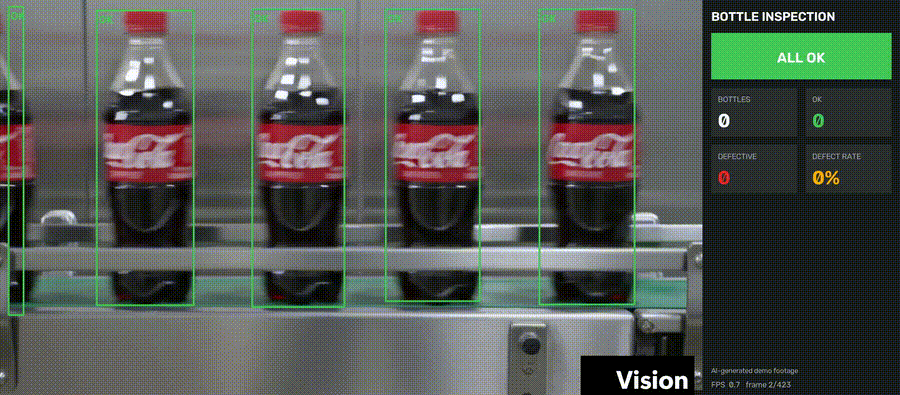

# DefectDetect-AI

Bottle inspection on a conveyor line. Detects each bottle, checks the cap and the fill level, and flags defective bottles on a live dashboard.



> The demo footage is AI-generated (Kling). It shows the pipeline working and is not real factory footage.

## What it does

- Detects and tracks every bottle across frames (YOLO11s + ByteTrack)
- Checks two things per bottle: the cap (`Capped` / `No Cap`) and the fill level (`Normal` / `Overfilled` / `Underfilled`)
- Highlights any non-normal bottle with a thick red box, a red tint and a `DEFECT: <type>` tag
- Dashboard panel: status banner (ALL OK / DEFECT DETECTED), bottles / OK / defective / defect rate, FPS

## Results

Evaluated on the test split of my own labeled frames (59 labeled frames in total, 6 test images):

| Precision | Recall | mAP50 | mAP50-95 |
|---|---|---|---|
| 0.867 | 0.816 | 0.827 | 0.607 |

mAP50-95 per class:

| bottle | Underfilled | Normal | No Cap | Capped | Overfilled |
|---|---|---|---|---|---|
| 0.834 | 0.772 | 0.652 | 0.557 | 0.543 | 0.286 |


### Limitations

- Tiny dataset: 59 frames from one AI-generated clip, with only 13 `Overfilled` and about 30 each of `No Cap` and `Underfilled` labels.
- Neighbouring video frames are near-duplicates, so these scores are optimistic.
- The per-class numbers for `No Cap` and `Overfilled` come from 5 test instances each and are not reliable.
- Not validated on real factory footage or other bottle types.

## Run it

```bash
pip install -r requirements.txt
python dashboard.py --weights best.pt --source your_video.mp4 --show
```

Options: `--out` (output file), `--conf` (default 0.4), `--imgsz` (default 640), `--note` (footer text).
The annotated video is saved as `inspection_output.mp4`.

## How it decides

1. The model tracks whole bottles (class `bottle`).
2. Cap and fill boxes whose centre is inside a bottle box belong to that bottle.
3. A bottle counts after 3 tracked frames, and a defect is confirmed after 3 frames, so one noisy frame does not change the counts (`MIN_FRAMES`, `MIN_VOTES` in `dashboard.py`).

## Training

- Labeled in Roboflow: 6 classes (`bottle`, `Capped`, `No Cap`, `Normal`, `Underfilled`, `Overfilled`), 888 boxes on 59 frames
- YOLO11s from COCO weights, 150 epochs, imgsz 640, `freeze=10`, on a Kaggle T4
- The dataset is not included in this repo

An earlier model trained on a public bottle dataset (Roboflow Universe, "bottle detection" by davidbottle defect inspection, CC BY 4.0) scored well on its own test split but found almost nothing in the new footage, so the final model uses only my own labeled frames.

## Files

- `dashboard.py`: inference, tracking, highlighting and dashboard
- `best.pt`: trained weights
- `demo/`: annotated demo GIF
- `assets/`: training curves and confusion matrix
